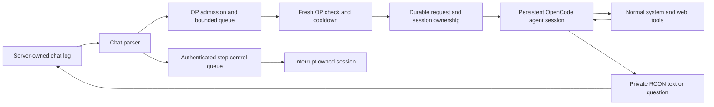

# Architecture

- `internal/minecraft`: log parsing/tailing and OP checks. Standard online-mode logs are trusted input, not cryptographic identity evidence.
- `internal/bot`: bounded queues, durable cooldown/request budgets, full-agent dispatch/session ownership/recovery, and journals. Optional command/planner modes retain independent Go policy and RCON verification.
- `internal/opencode`: pinned OpenCode client. Full agent sessions select a provider/model and Build/custom agent at the Minecraft working directory with allow-all tools. Polling returns text/questions; answers and interruption use native APIs. The separate stateless adapter supports read-only diagnostics.
- `internal/rcon`: private chat delivery and optional explicit command execution.
- `internal/config`: strict JSON with loopback destinations, mode/provider selection, timeout and limits.
- `cmd/minecraft-server-agent`: setup, diagnostics, lifecycle and reply formatting.
- `tools/check`, `tools/contract`, `tools/release`: shared GitHub/GitLab validation and distribution.

Agent mode authorizes dispatch, not individual tool actions. OpenCode owns its tool inventory, agent loop, model retries, tool outputs and detailed transcript; the bridge does not impose an operation allowlist. Workspace content and tool output can reach the inference provider. The OS account determines actual privileges.

Each OP UUID owns a separate persistent session. Session IDs are durably recorded before prompting, and accepted IDs are never automatically replayed. Native questions release the request worker so another OP can run work; answer ownership is enforced by session routing. Stop controls bypass the occupied request queue. Authorization changes during foreground work trigger interruption attempts.

Agent interaction and read-only inference ledgers are separate. A full interaction can contain multiple provider/tool calls. Restarting the bridge does not reset recorded request allowances or session ownership.

Auditing and tools do not form a transaction. Interruption does not undo changes or necessarily stop detached processes. Startup/shutdown interrupts only sessions recorded by this bridge; crashes require inspection and normal server recovery. There is no Go-native restart supervisor or mod installer; these workflows are delegated to the full agent.

GitHub Actions tests Windows/Linux; GitLab runs shared checks on Linux. Both execute real-runtime/fake-provider contracts and package Windows/Linux amd64/arm64. No automated live deployment or paid inference is used in CI.
